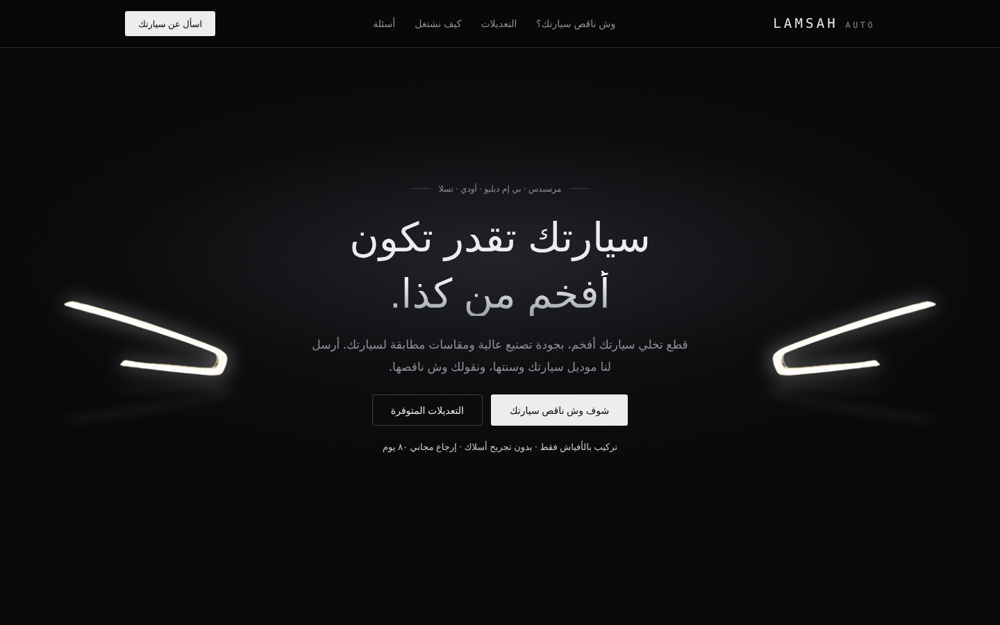
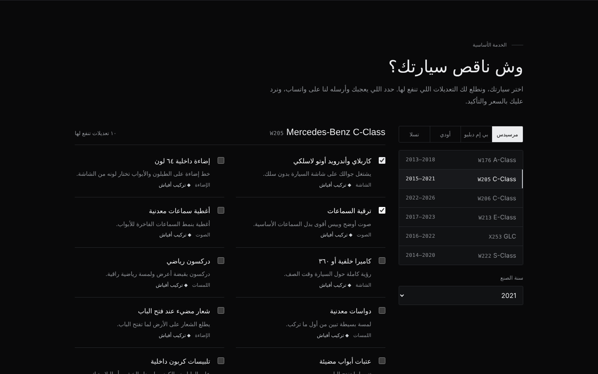
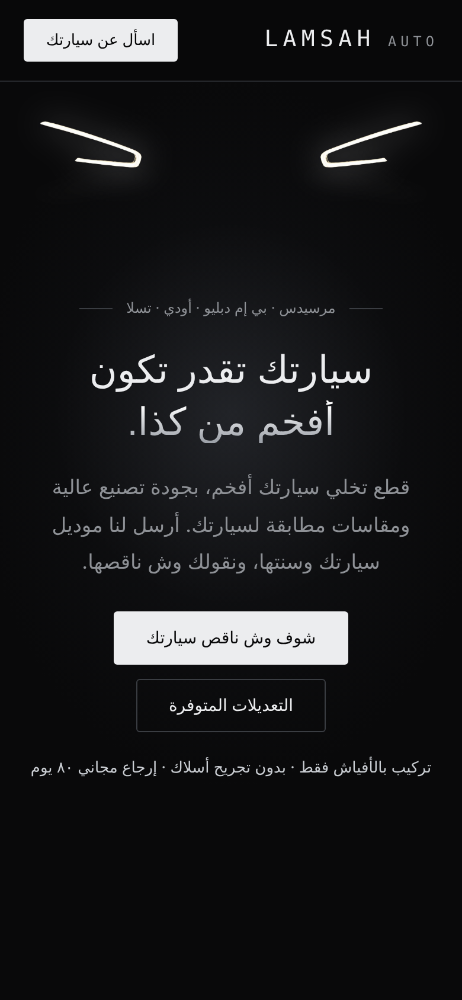

# Lamsah Auto · لمسة أوتو

A dark, premium landing page for a car-upgrades store (Mercedes-Benz, BMW, Audi, Tesla).
Built as a single static page with plain HTML, CSS and JavaScript.



## Features
- **Light signature intro**: LED headlight strips switch on with the visitor's first interaction (click, scroll, key or touch)
- **"What's missing on your car?" finder**: pick brand, model and year to see only the upgrades that fit that car
- **WhatsApp ordering**: selected car and parts are sent as a ready-made WhatsApp message
- **Before / after slider** for the interior
- Fully responsive, RTL Arabic layout





## Run it
No build step. Open `index.html` in a browser, or serve the folder:

```bash
npx serve .
```

## Tech
HTML · CSS · JavaScript
